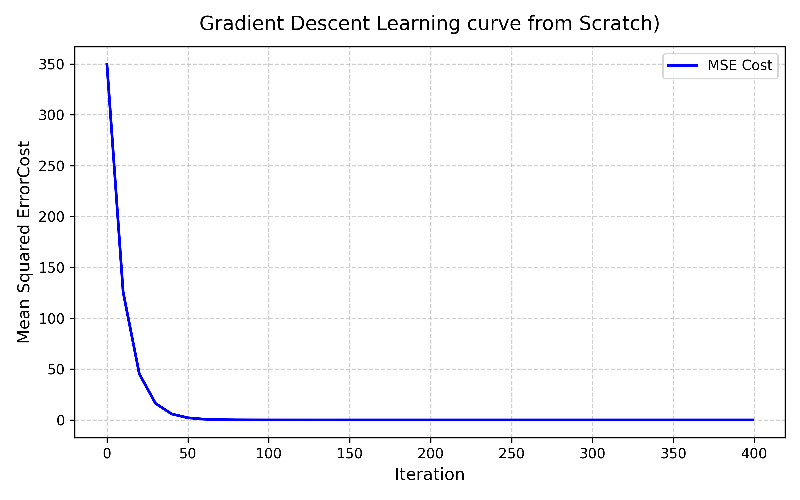

# Linear Regression (From Scratch) 

A fully vectorized implementation of Multiple Linear Regression built from first principles using pure Python and NumPy. 

## Objective
As a mechanical engineering student transitioning into ML, I built this project to bridge the gap between theoretical calculus/linear algebra and practical software engineering. Instead of relying on black-box frameworks like `scikit-learn` or `TensorFlow`, this project implements the core mechanics under the hood.

##  Technical Highlights
* **Vectorized Operations:** Replaced procedural `for` loops with optimized NumPy matrix multiplications (`np.dot`) for forward propagation.
* **Batch Gradient Descent:** Implemented analytical partial derivatives to iteratively minimize the Mean Squared Error (MSE).
* **Feature Scaling:** Custom Z-score normalization using 2D array broadcasting.
* **Convergence Diagnostics:** Tracked objective function minimization across iterations and plotted the learning curve using Matplotlib.

##  Visualizing the Cost Function

##  Tech Stack
* **Language:** Python 3.10
* **Libraries:** NumPy, Matplotlib
* **Environment:** Linux (WSL2 / Ubuntu)